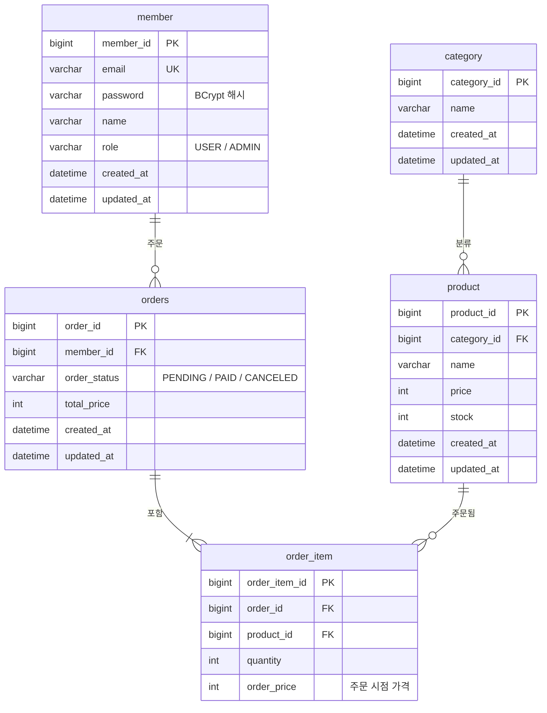

# Shop API


Spring Boot 기반 커머스 백엔드 API

회원, 카테고리, 상품, 주문 도메인을 JPA로 설계하고, 상품 조회 · 회원가입/로그인 · JWT 인증 · 주문 API를 미션 단위로 구현한 프로젝트입니다.
기능을 만드는 것보다 **왜 이렇게 설계했는지 기록하고, 직접 실험해서 확인하는 것**을 목표로 했습니다.

## 목차

1. [기술 스택](#기술-스택)
2. [주요 기능](#주요-기능)
3. [핵심 설계와 고민](#핵심-설계와-고민)
4. [ERD](#erd)
5. [패키지 구조](#패키지-구조)
6. [요청 흐름](#요청-흐름)
7. [에러 응답](#에러-응답)
8. [테스트](#테스트)
9. [트러블슈팅](#트러블슈팅)
10. [실행 방법](#실행-방법)
11. [학습 기록](#학습-기록)
12. [앞으로 할 것](#앞으로-할-것)

## 기술 스택

| 구분 | 기술 |
|---|---|
| Language | Java 17 |
| Framework | Spring Boot 4.1, Spring Data JPA (Hibernate), Spring Security, Bean Validation |
| 인증 | JWT (jjwt 0.12), BCrypt |
| Database | MySQL 8.4 (Docker Compose) |
| Test | JUnit 5, AssertJ, Testcontainers (MySQL), MockMvc |
| Docs | springdoc-openapi (Swagger UI) |
| Build | Gradle |

## 주요 기능

| 메서드 | 경로 | 설명 | 인증 |
|---|---|---|---|
| GET | `/api/products?keyword=&page=&size=&sort=` | 상품 목록 (이름 검색, 페이징, 기본 최신순) | X |
| GET | `/api/products/{id}` | 상품 상세 (없으면 404 `PRODUCT_NOT_FOUND`) | X |
| POST | `/api/auth/signup` | 회원가입 (201, 중복 이메일이면 409 `DUPLICATE_EMAIL`) | X |
| POST | `/api/auth/login` | 로그인, `{accessToken, tokenType, expiresIn}` 반환 (실패 시 401 `FAIL_LOGIN`) | X |
| GET | `/api/members/me` | 내 정보 조회 `{id, email, name, role}` | O |
| POST | `/api/orders` | 주문 생성 + 재고 차감 (201, 재고 부족 409 `OUT_OF_STOCK`, 상품/회원 없음 404) | O |

- 인증이 필요한 API는 `Authorization: Bearer <accessToken>` 헤더가 필요합니다.
- 실행 후 Swagger UI(http://localhost:8080/swagger-ui.html)에서 직접 호출해 볼 수 있습니다.

## 핵심 설계와 고민

각 항목의 자세한 내용은 링크한 학습 기록에 있습니다.

### 1. 주문과 재고를 하나의 트랜잭션으로 묶기 → [08. 주문 생성 API](docs/08-order.md)

- 주문 저장과 재고 차감을 `@Transactional` 하나로 묶었습니다. 재고 차감은 `UPDATE`를 직접 쓰지 않고 **dirty checking**에 맡깁니다.
- **`@Transactional`을 일부러 지우는 실험**을 했습니다. 주문은 저장되는데 재고는 그대로인 데이터 불일치가 생겼고, `createOrder_decreasesStock` 테스트도 실패했습니다. `open-in-view: false`라 Repository 호출마다 영속성 컨텍스트가 따로 열려서, 재고를 바꾼 상품이 준영속 상태가 되었기 때문입니다.
- `OrderItem`의 생성자를 `private`으로 막고 `OrderItem.create()`에서만 재고를 차감하게 해서, **재고 차감 없이 주문 항목을 만드는 실수를 컴파일 단계에서** 막았습니다.
- 재고 부족은 400이 아니라 **409 CONFLICT**로 응답합니다. 요청 형식은 맞지만 서버의 현재 상태와 충돌하는 경우이기 때문입니다.

### 2. N+1 문제 → [04. 상품 조회 API](docs/04-product-api.md), [00. 초기 세팅](docs/00-project-setup.md)

- 상품 목록에서 카테고리를 `@EntityGraph`로 함께 조회해서, **SQL 로그로 SELECT 2번(목록 + count)만 나가는 것**을 확인했습니다.
- 기본 안전장치로 `default_batch_fetch_size: 100`을 두었습니다. 컬렉션은 fetch join과 페이징을 같이 쓸 수 없어서 IN 쿼리로 묶는 방식이 필요합니다.

### 3. JWT 인증과 401/403 JSON 응답 → [06. JWT 발급](docs/06-jwt.md), [07. JWT 인증 필터](docs/07-jwt-filter.md)

- `OncePerRequestFilter`로 토큰을 검증하고, 성공하면 SecurityContext에 `memberId`와 권한을 저장합니다. 컨트롤러에서는 `@AuthenticationPrincipal`로 꺼냅니다.
- 필터에서 나는 예외는 `@RestControllerAdvice`가 잡지 못합니다. 그래서 `AuthenticationEntryPoint`(401)와 `AccessDeniedHandler`(403)가 다른 API와 **같은 에러 형식**으로 응답하게 했습니다.
- JWT secret은 `.env`와 환경변수로 관리해서 저장소에 올라가지 않습니다. 값이 없으면 애플리케이션이 시작되지 않습니다.

### 4. 보안을 고려한 회원 API → [05. 회원가입 / 로그인 API](docs/05-auth-api.md)

- 비밀번호는 BCrypt 해시로 저장합니다.
- 로그인할 때 "없는 이메일"과 "틀린 비밀번호"를 같은 401로 응답합니다. 응답만 보고 가입된 이메일을 알아낼 수 없게 하기 위해서입니다(계정 열거 방지).
- 응답 DTO를 따로 두어 엔티티(비밀번호 해시 포함)가 그대로 노출되지 않게 했습니다. 응답에는 클라이언트가 필요한 값만 담습니다.

### 5. 일관된 예외 처리 → [01. 공통 코드](docs/01-common-code.md)

- `ErrorCode` enum이 HTTP 상태와 메시지를 가지고, `BusinessException`(`RuntimeException` 상속)이 이를 담아 던집니다.
- `GlobalExceptionHandler`가 예상한 예외는 `ErrorCode`대로, 예상하지 못한 예외는 500 + 에러 로그로 처리합니다.

### 6. 운영과 같은 DB로 테스트 → [03. 테스트](docs/03-testing.md)

- H2 대신 **Testcontainers로 MySQL 8.4**를 띄워서 통합 테스트를 합니다. 예약어나 문법 차이를 테스트 단계에서 잡을 수 있습니다.
- 주문 통합 테스트에는 `@Transactional`을 붙이지 않았습니다. 붙이면 1차 캐시 때문에 실제 DB 반영 여부를 확인할 수 없기 때문입니다.

## ERD



- `orders`: `order`는 SQL 예약어라 복수형 사용
- `order_item.order_price`: 상품 가격이 바뀌어도 과거 주문 금액이 유지되도록 주문 시점 가격을 따로 저장
- `orders` ↔ `order_item`: 1:N 양방향, 주문과 함께 저장/삭제 (cascade, orphanRemoval)
- 모든 연관관계는 지연 로딩(`LAZY`)

## 패키지 구조

도메인별로 패키지를 나누고, 여러 도메인이 함께 쓰는 코드는 `global`에 두었습니다.

```
src/main/java/com/lsch/shop
├── domain
│   ├── auth        회원가입, 로그인 (controller, service, dto)
│   ├── member      회원 엔티티, 내 정보 조회
│   ├── category    카테고리 엔티티
│   ├── product     상품 엔티티, 목록/상세 조회
│   └── order       주문/주문 항목 엔티티, 주문 생성
│       ├── controller
│       ├── service
│       ├── repository
│       ├── dto
│       └── entity
└── global
    ├── config      Security, JPA Auditing, Swagger 설정
    ├── entity      BaseTimeEntity (created_at, updated_at)
    ├── error       ErrorCode, ErrorResponse, BusinessException, GlobalExceptionHandler
    └── security    JwtProvider, JwtAuthenticationFilter, 401/403 핸들러
```

## 요청 흐름

`POST /api/orders` 기준입니다.

```
Client ── Authorization: Bearer <token>
  │
  ▼
JwtAuthenticationFilter        토큰 검증 → SecurityContext (principal = memberId)
  │                              토큰 없음 / 유효하지 않음 → EntryPoint → 401 JSON
  ▼
OrderController                @Valid 검증 실패 → 400 INVALID_INPUT
  │
  ▼
OrderService (@Transactional)  ── 트랜잭션 시작 ──
  │  회원 조회                    없으면 404 MEMBER_NOT_FOUND
  │  상품 일괄 조회 (findAllById)  하나라도 없으면 404 PRODUCT_NOT_FOUND
  │  OrderItem.create            재고 차감, 부족하면 409 OUT_OF_STOCK
  │  Order.create → save         INSERT orders, order_item
  │                              ── 커밋: dirty checking → UPDATE product ──
  ▼
201 Created  { id, orderStatus, totalPrice, items }
```

## 에러 응답

모든 에러는 같은 형식으로 응답합니다.

```json
{ "code": "OUT_OF_STOCK", "message": "재고가 부족합니다" }
```

| 상태 | code 예시 |
|---|---|
| 400 | `INVALID_INPUT`, `INVALID_JSON` |
| 401 | `UNAUTHORIZED`, `FAIL_LOGIN` |
| 403 | `FORBIDDEN` |
| 404 | `PRODUCT_NOT_FOUND`, `MEMBER_NOT_FOUND`, `NOT_FOUND` |
| 409 | `DUPLICATE_EMAIL`, `OUT_OF_STOCK`, `ALREADY_CANCELED_ORDER` |
| 500 | `SYSTEM_ERROR` |

전체 에러 코드, 발생 위치, 상태 코드를 고른 기준(400 vs 409, 401 vs 403): [docs/error-codes.md](docs/error-codes.md)

## 테스트

```bash
./gradlew test
```

- 전체 24개 테스트
- Testcontainers가 테스트용 MySQL 컨테이너를 자동으로 띄웁니다. **Docker만 실행 중이면 되고**, `docker compose up`은 필요 없습니다.

| 종류 | 테스트 | 내용 |
|---|---|---|
| 단위 | `ProductTest` | 재고 차감, 재고 부족, 잘못된 수량 |
| 단위 | `OrderTest` | 총액 계산, 주문 취소 시 재고 복구, 중복 취소 예외 |
| 단위 | `JwtProviderTest` | 토큰 정상 / 만료 / 다른 키 / 형식 오류 |
| 슬라이스 | `GlobalExceptionHandlerTest` | `@WebMvcTest`로 예외 → 에러 응답 변환 |
| 통합 | `OrderServiceTest` | 재고 차감, 재고 부족, 일부 재고 부족 시 전체 롤백, 같은 상품 중복 주문, 상품/회원 없음 |
| 통합 | `ShopApplicationTests` | 컨텍스트 로딩 |

## 트러블슈팅

실제로 겪은 문제를 **상황 → 원인 → 해결 → 배운 점** 순서로 정리했습니다. 전체 내용: [docs/troubleshooting.md](docs/troubleshooting.md)

| # | 문제 | 키워드 |
|---|---|---|
| 1 | `attributePaths`와 `@JoinColumn`의 기준 차이 (필드 이름 vs 컬럼 이름) | `@EntityGraph`, 연관관계 매핑 |
| 2 | Jackson 3 / jjwt 0.12 패키지 변경과 같은 이름의 클래스 | Spring Boot 4, 라이브러리 메이저 버전 |
| 3 | SecurityConfig에 의존성을 추가하자 `@WebMvcTest`가 깨짐 | 슬라이스 테스트, `@MockitoBean` |
| 4 | `getById`로 조회한 엔티티에서 `LazyInitializationException` | 프록시, OSIV |
| 5 | 없는 ID로 `10L`을 쓰면 순서에 따라 깨질 수 있음 | flaky 테스트, AUTO_INCREMENT |

## 실행 방법

```bash
# 1. .env 생성 후 JWT_SECRET 채우기 (값 생성: openssl rand -base64 48)
cp .env.example .env

# 2. DB 실행 (localhost:3308, 외부 네트워크에서는 접속 불가)
docker compose up -d

# 3. 애플리케이션 실행 (기본 프로필: local)
./gradlew bootRun
```

- Swagger UI: http://localhost:8080/swagger-ui.html
- `local` 프로필에서는 `data.sql`로 샘플 카테고리와 상품이 들어갑니다.

<details>
<summary><b>환경변수와 프로필</b></summary>

### JWT secret

`application-local.yml`은 프로젝트 루트의 `.env`를 읽습니다(`spring.config.import: optional:file:.env[.properties]`). `.env`는 git에 올리지 않고, 필요한 키는 [`.env.example`](.env.example)에 정리했습니다.

| 환경변수 | 설명 | 기본값 |
|---|---|---|
| `JWT_SECRET` | HS256 서명 키. Base64 문자열이고, 디코딩하면 32바이트 이상이어야 합니다 | 없음 (값이 없으면 기동 실패) |

- `.env` 대신 OS 환경변수나 IDE 실행 설정으로 `JWT_SECRET`을 넣어도 됩니다.
- `.env`는 실행할 때의 작업 디렉터리를 기준으로 찾습니다. 프로젝트 루트에서 실행하세요.
- 테스트는 `.env`가 필요 없습니다. `application-test.yml`에 테스트 전용 secret이 들어 있습니다.

### DB 접속 정보

`application-local.yml`은 환경변수를 우선 사용하고, 없으면 docker-compose 기본값을 사용합니다.

| 환경변수 | 기본값 |
|---|---|
| `DB_HOST` | `localhost` |
| `DB_PORT` | `3308` |
| `DB_NAME` | `shop` |
| `DB_USERNAME` | `shop` |
| `DB_PASSWORD` | `shop` |

### 프로필

| 프로필 | 용도 | 파일 |
|---|---|---|
| `local` (기본) | 로컬 개발, `ddl-auto: update`, SQL·파라미터 로그 | `application-local.yml` |
| `test` | 테스트, Testcontainers + `ddl-auto: create-drop` | `src/test/resources/application-test.yml` |

</details>

## 학습 기록

미션마다 "무엇을 만들었는지"보다 **"왜 이렇게 했는지"** 위주로 정리했습니다. 전체 목차와 미션 로드맵: [docs/README.md](docs/README.md)

| 문서 | 내용 |
|---|---|
| [00. 프로젝트 초기 세팅](docs/00-project-setup.md) | 의존성, Docker MySQL, 프로필 분리, OSIV, batch fetch size, Testcontainers |
| [01. 공통 코드](docs/01-common-code.md) | BaseTimeEntity, ErrorCode, BusinessException, 전역 예외 처리, record/class 선택 기준 |
| [02. 엔티티 설계](docs/02-entity-design.md) | 연관관계 매핑과 주인, 지연 로딩, cascade/orphanRemoval, 편의 메서드, 주문 시점 가격 |
| [03. 테스트](docs/03-testing.md) | 단위/슬라이스/통합 테스트, AssertJ, 예외 검증 |
| [04. 상품 조회 API](docs/04-product-api.md) | 페이징 검색, N+1과 `@EntityGraph` |
| [05. 회원가입 / 로그인 API](docs/05-auth-api.md) | Bean Validation, BCrypt, 계정 열거 방지 |
| [06. JWT 발급](docs/06-jwt.md) | secret 관리, 키 길이와 알고리즘, 토큰 생성/검증 |
| [07. JWT 인증 필터](docs/07-jwt-filter.md) | `OncePerRequestFilter`, 경로별 인가, 401/403 JSON |
| [08. 주문 생성 API](docs/08-order.md) | `@Transactional` 제거 실험, dirty checking, OSIV, 통합 테스트 설계 |
| [에러 코드와 HTTP 상태](docs/error-codes.md) | 전체 에러 코드 목록, 상태 코드 선택 기준, 새 에러 추가 방법 |

브랜치, 커밋 메시지, PR 규칙은 [CONTRIBUTING.md](CONTRIBUTING.md)에 정리했습니다.

## 앞으로 할 것

- [ ] AWS 배포
- [ ] 재고 동시성 문제(Lost Update) 재현 및 해결 (비관적 락 / 낙관적 락 비교)
- [ ] 주문 취소, 내 주문 목록 조회 API
- [x] 주문 생성 시 상품 조회를 `findAllById`로 묶기
- [ ] MockMvc 컨트롤러 테스트
- [ ] Refresh Token
