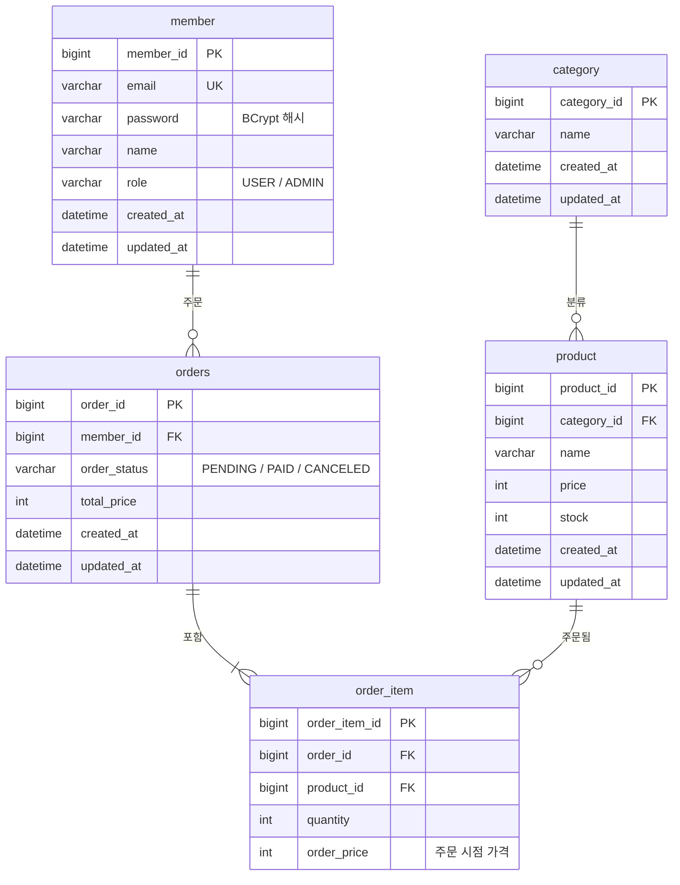

# Shop API

Spring Boot 기반 커머스 백엔드 API

회원, 카테고리, 상품, 주문 도메인을 JPA로 설계하고, 상품 조회 · 회원가입/로그인 · JWT 인증 · 주문 API를 단계적으로 구현하는 프로젝트입니다.

## ERD



- `orders`: `order`는 SQL 예약어라 복수형 사용
- `order_item.order_price`: 상품 가격이 바뀌어도 과거 주문 금액이 유지되도록 주문 시점 가격을 따로 저장
- `orders` ↔ `order_item`: 1:N 양방향, 주문과 함께 저장/삭제 (cascade, orphanRemoval)

## 기술 스택

- Java 17, Spring Boot 4.1
- Spring Data JPA, Spring Security, Bean Validation
- MySQL 8.4 (Docker)
- springdoc-openapi (Swagger UI)
- 테스트: JUnit 5, Testcontainers

## 실행 방법

```bash
# 1. DB 실행 (localhost:3308, 외부 네트워크에서는 접속 불가)
docker compose up -d

# 2. 애플리케이션 실행 (기본 프로필: local)
./gradlew bootRun
```

- Swagger UI: http://localhost:8080/swagger-ui.html

### DB 접속 정보 변경

`application-local.yml`은 환경변수를 우선 사용하고, 없으면 docker-compose 기본값을 사용합니다.

| 환경변수 | 기본값 |
|---|---|
| `DB_HOST` | `localhost` |
| `DB_PORT` | `3308` |
| `DB_NAME` | `shop` |
| `DB_USERNAME` | `shop` |
| `DB_PASSWORD` | `shop` |

## 테스트

```bash
./gradlew test
```

Testcontainers가 테스트용 MySQL 컨테이너를 자동으로 띄웁니다. Docker만 실행 중이면 되고, `docker compose up`은 필요 없습니다.

## 학습 기록

미션별로 공부한 내용과 트러블슈팅을 [`docs/`](docs/README.md)에 정리했습니다.

## 프로필

| 프로필 | 용도 | 파일 |
|---|---|---|
| `local` (기본) | 로컬 개발, `ddl-auto: update`, SQL·파라미터 로그 | `application-local.yml` |
| `test` | 테스트, Testcontainers + `ddl-auto: create-drop` | `src/test/resources/application-test.yml` |
