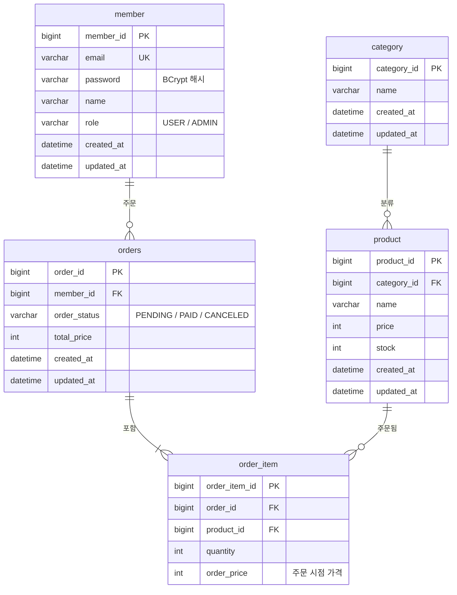

# Shop API

Spring Boot 기반 커머스 백엔드 API

회원, 카테고리, 상품, 주문 도메인을 JPA로 설계하고, 상품 조회 · 회원가입/로그인 · JWT 인증 · 주문 API를 단계적으로 구현하는 프로젝트입니다.

## ERD



- `orders`: `order`는 SQL 예약어라 복수형 사용
- `order_item.order_price`: 상품 가격이 바뀌어도 과거 주문 금액이 유지되도록 주문 시점 가격을 따로 저장
- `orders` ↔ `order_item`: 1:N 양방향, 주문과 함께 저장/삭제 (cascade, orphanRemoval)

## API

| 메서드 | 경로 | 설명 | 인증 |
|---|---|---|---|
| GET | `/api/products?keyword=&page=&size=&sort=` | 상품 목록 (이름 검색, 페이징, 기본 최신순) | X |
| GET | `/api/products/{id}` | 상품 상세 (없으면 404 `PRODUCT_NOT_FOUND`) | X |
| POST | `/api/auth/signup` | 회원가입 (201, 중복 이메일이면 409 `DUPLICATE_EMAIL`) | X |
| POST | `/api/auth/login` | 로그인, `{accessToken, tokenType, expiresIn}` 반환 (실패 시 401 `FAIL_LOGIN`) | X |
| GET | `/api/members/me` | 내 정보 조회 `{id, email, name, role}` | O |
| POST | `/api/orders` | 주문 생성 + 재고 차감 (201, 재고 부족 409 `OUT_OF_STOCK`, 상품/회원 없음 404) | O |

에러 응답은 모두 `{"code": "ERROR_CODE", "message": "..."}` 형식입니다.

인증이 필요한 API는 `Authorization: Bearer <accessToken>` 헤더가 필요합니다. 토큰이 없거나 유효하지 않으면 401 `UNAUTHORIZED`, 권한이 부족하면 403 `FORBIDDEN`을 응답합니다.

## 기술 스택

- Java 17, Spring Boot 4.1
- Spring Data JPA, Spring Security, Bean Validation
- MySQL 8.4 (Docker)
- springdoc-openapi (Swagger UI)
- 테스트: JUnit 5, Testcontainers

## 실행 방법

```bash
# 1. .env 생성 후 JWT_SECRET 채우기 (값 생성: openssl rand -base64 48)
cp .env.example .env

# 2. DB 실행 (localhost:3308, 외부 네트워크에서는 접속 불가)
docker compose up -d

# 3. 애플리케이션 실행 (기본 프로필: local)
./gradlew bootRun
```

- Swagger UI: http://localhost:8080/swagger-ui.html

### JWT secret 설정

`application-local.yml`은 프로젝트 루트의 `.env`를 읽습니다(`spring.config.import: optional:file:.env[.properties]`). `.env`는 git에 올리지 않고, 필요한 키는 [`.env.example`](.env.example)에 정리했습니다.

| 환경변수 | 설명 | 기본값 |
|---|---|---|
| `JWT_SECRET` | HS256 서명 키. Base64 문자열이고, 디코딩하면 32바이트 이상이어야 합니다 | 없음 (값이 없으면 기동 실패) |

- `.env` 대신 OS 환경변수나 IDE 실행 설정으로 `JWT_SECRET`을 넣어도 됩니다.
- `.env`는 실행할 때의 작업 디렉터리를 기준으로 찾습니다. 프로젝트 루트에서 실행하세요.
- 테스트는 `.env`가 필요 없습니다. `application-test.yml`에 테스트 전용 secret이 들어 있습니다.

### DB 접속 정보 변경

`application-local.yml`은 환경변수를 우선 사용하고, 없으면 docker-compose 기본값을 사용합니다.

| 환경변수 | 기본값 |
|---|---|
| `DB_HOST` | `localhost` |
| `DB_PORT` | `3308` |
| `DB_NAME` | `shop` |
| `DB_USERNAME` | `shop` |
| `DB_PASSWORD` | `shop` |

## 테스트

```bash
./gradlew test
```

Testcontainers가 테스트용 MySQL 컨테이너를 자동으로 띄웁니다. Docker만 실행 중이면 되고, `docker compose up`은 필요 없습니다.

## 학습 기록

미션별로 공부한 내용과 트러블슈팅을 [`docs/`](docs/README.md)에 정리했습니다.

## 프로필

| 프로필 | 용도 | 파일 |
|---|---|---|
| `local` (기본) | 로컬 개발, `ddl-auto: update`, SQL·파라미터 로그 | `application-local.yml` |
| `test` | 테스트, Testcontainers + `ddl-auto: create-drop` | `src/test/resources/application-test.yml` |
